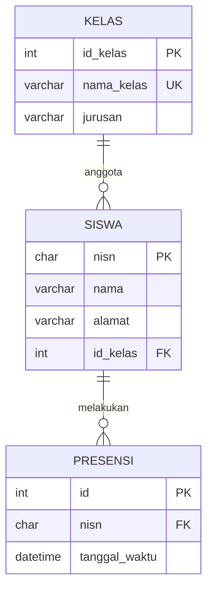

# Aplikasi Presensi Siswa

Aplikasi web untuk mencatat presensi siswa lewat simulasi tap kartu RFID di gerbang SMK TI Airlangga Samarinda.
Dibuat dengan **PHP native (PDO + OOP)** dan **MariaDB**. Pengguna tunggal: Administrator.

## Fitur
1. Login & Logout (session, `password_hash` / `password_verify`)
2. Kelola Kelas (CRUD, kelas yang masih punya siswa tidak bisa dihapus)
3. Kelola Siswa (CRUD, validasi NISN 10 digit sebagai teks, `INNER JOIN` nama kelas)
4. Simulasi Tap Kartu (hanya mengirim NISN; id dan waktu diisi otomatis oleh database)
5. Rekap Presensi (`INNER JOIN` 3 tabel, filter tanggal (default hari ini) dan kelas, log bisa dihapus, tidak bisa diubah)
6. Pencarian siswa (nama / NISN) dan pencarian + filter tanggal presensi

## Struktur Project
```
presensi/
├── schema.sql          # DDL + seeder
├── config/database.php # konfigurasi koneksi
├── app/                # Database, BaseModel, Kelas, Siswa, Presensi, User, helpers, init
├── layouts/            # header.php, navbar.php, footer.php
├── assets/css/style.css
├── auth.php            # auth guard (cek session)
├── login.php, logout.php
├── index.php           # rekap presensi
├── tap.php             # simulasi tap kartu
├── kelas.php, kelas_form.php
└── siswa.php, siswa_form.php
```

## Cara Instalasi
1. Salin folder `presensi` ke `htdocs` (XAMPP) atau `www` (Laragon).
2. Jalankan Apache dan MySQL/MariaDB.
3. Buka phpMyAdmin, **Import** file `schema.sql` (membuat database `presensi_siswa`, tabel, dan data awal).
4. Cek `config/database.php` (default: user `root`, password kosong).
5. Buka `http://localhost/presensi/login.php`.

## Akun Demo
| Username | Password |
|---|---|
| admin | admin123 |

## ERD (Notasi Chen)
Satu kelas memiliki banyak siswa (1 : N), satu siswa memiliki banyak presensi (1 : N).
Tabel `users` berdiri sendiri.



> Tambahkan juga gambar ERD dari soal ke folder `docs/` lalu tautkan di sini.

## Hasil Pengujian
Isi kolom hasil setelah menjalankan aplikasi, lalu tempel tangkapan layar di folder `docs/`.

| No | Skenario Uji | Hasil yang Diharapkan | Hasil | Bukti |
|---|---|---|---|---|
| 1 | Login dengan password salah | Gagal, muncul pesan kesalahan | | docs/uji1.png |
| 2 | Buka halaman tanpa login lewat URL langsung | Diarahkan ke halaman login | | docs/uji2.png |
| 3 | Tambah siswa dengan NISN 9 digit | Validasi gagal, pesan muncul, isian tidak hilang | | docs/uji3.png |
| 4 | Tambah siswa dengan NISN yang sudah ada | Ditolak dengan pesan NISN sudah terdaftar | | docs/uji4.png |
| 5 | Simulasi tap dengan NISN tidak terdaftar | Ditolak dengan pesan yang jelas | | docs/uji5.png |
| 6 | Simulasi tap dengan NISN valid | Muncul di rekap hari ini, waktu terisi otomatis | | docs/uji6.png |
| 7 | Hapus kelas yang masih memiliki siswa | Ditolak dengan pesan yang mudah dipahami | | docs/uji7.png |
| 8 | Cari siswa berdasarkan sebagian nama | Hanya siswa yang sesuai yang tampil | | docs/uji8.png |

Tampilan smartphone juga diuji (responsif: `viewport`, tabel bisa digeser).

## Keamanan
- Semua query memakai prepared statement.
- Password disimpan dengan `password_hash`, dicek dengan `password_verify`.
- Semua output memakai `htmlspecialchars` (fungsi `e()`).
- Halaman selain login dilindungi `auth.php`.

## Tangkapan Layar
Tempel tangkapan layar halaman login, rekap, tap kartu, kelas, dan siswa di folder `docs/`.
